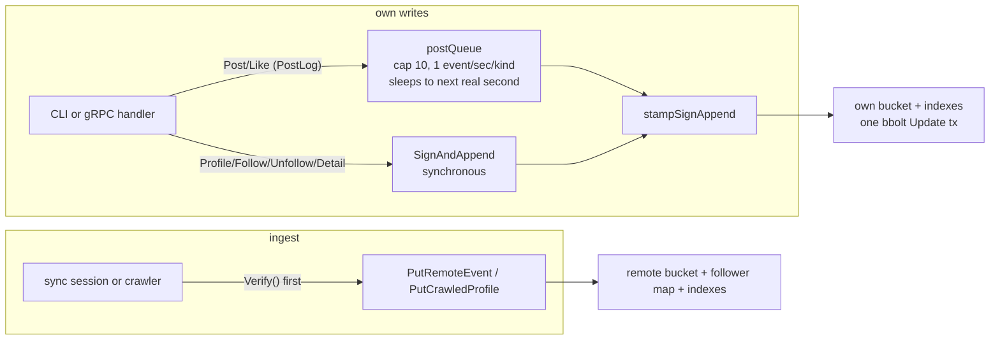
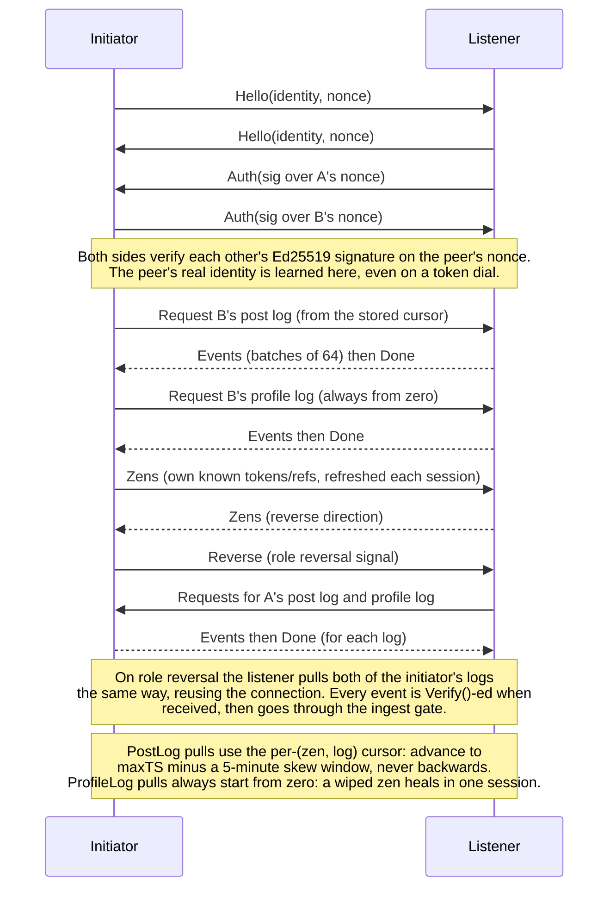
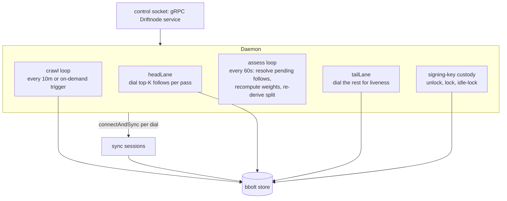

# driftnode architecture

This is the canonical reference for how driftnode works, derived from the current
code. When a plan document (serverless-social-network-design.md, docs/*-plan.md)
conflicts with this file or with the code, the code wins.

Scope: one Go binary (internal/ packages below), a bbolt store, and a local daemon.

```text
internal/
  core       identity, canonical CBOR, event model, signing, follow PoW, backup format
  store      bbolt persistence: own/remote events, indexes, follower map, LRUs, ingest gates
  net        tailcat (WireGuard) transport: listener, dialer, address tokens. TCP port 7421
  sync       wire protocol (length-prefixed CBOR) and bidirectional sync sessions
  crawler    BFS over public profile logs into the crawl LRU cache
  weight     sync-priority scoring of followed zens
  daemon     long-running node: control socket, scheduler lanes, signing key custody
  proto      gRPC control plane (driftnode.v1.Driftnode, committed generated bindings)
  cli        cobra commands over the daemon RPC, with offline store fallback
  tui        Bubble Tea dashboard; thin gRPC client of the daemon, never opens the store
  bootstrap  signed bootstrap.yaml seed file (sign/verify at startup)
```

## Identity, events, and semantics

### Identity

- Ed25519 keypair. The keypair IS the account; there is no recovery outside a
  backup file. Identity string: `driftnode:<lowercase unpadded base32(pubkey)>`
  (`core.IdentityFromPubkey`, `core.ParseIdentity`, `core.ResolvePubkey`).
- Private key is encrypted at rest with argon2id (t=3, 32 MiB, 4 threads) plus
  AES-256-GCM (`core.DefaultKeyEncryption`), stored in the store's `key` bucket.
- Address token `tc<base64>` is the tailcat (WireGuard) address, derived from a
  separate persisted transport key. Identity is permanent; the token can rotate
  (`rotate-key`) without changing identity. Peers relearn tokens via zen exchange.

### Event model

Every state change is a signed event. Events are immutable; merging two views is
a set union keyed by event ID, never a conflict resolution.

- `Event{Kind, Log, Timestamp(unix ns), Sequence}` plus one payload pointer
  set (convention; neither `Sign` nor `validateEvent` enforces it). `EventID =
  BLAKE3-256(canonical event bytes)`. Canonical encoding is deterministic CBOR
  (`core.CoreDet` profile); it is what is signed, hashed, and put on the wire.
- `SignedEvent{Event, Author, Signature}`: the signature covers the canonical
  bytes of the Event only. `Verify()` re-derives the author from the identity
  string and checks the Ed25519 signature.

Kinds and logs (`core.CapForKind` caps the canonical event size):

| Kind | Value | Allowed log | Size cap | Notes |
|---|---|---|---|---|
| Profile | 1 | profile | 1024 | zen name, LWW profile projection |
| Follow | 2 | profile | 86 | carries PoW nonce |
| Unfollow | 3 | profile | 75 | no PoW |
| Post | 4 | post | 5120 | `ParentID` set = reply |
| Like | 5 | post | 72 | one per author per target, idempotent |
| Delete | 6 | post or detail | 72 | tombstone; cascades on post log |
| Detail | 7 | detail | 2048 | bio, names, location |

The three per-identity logs and how they are treated by current code. The
profile and post rows are enforced by what the crawler fetches and what the
lanes pull; the detail row is convention only: nothing in the ingest gate or
the sync server's log ACL (there is no per-log ACL) prevents a peer from
pushing or pulling detail events.

| Log | Contents | Treatment in current code |
|---|---|---|
| profile | Profile, Follow, Unfollow | public; fetched and cached by any peer's crawler |
| post | Post, Like, Delete | pulled from followed zens by the sync lanes and sessions |
| detail | Detail, Delete | never requested by the crawler or lanes; no on-demand fetch path exists yet |

Authored (own) events are never pruned and are the backup-critical set. Data from
other zens (synced posts, crawled profiles) is cache: re-fetchable at any time.

### Data semantics summary

- Set union everywhere: the same event ID stored twice merges to one copy.
- Follower: an identity whose Follow event targeting us we have personally
  received. Evidence bytes and the derived map record live together (the record
  is keyed inside the follower's author bucket, so eviction removes both).
- Reply = Post with `ParentID`. A referencing event (Like, reply, Delete) is
  stored remotely only if the target exists locally (orphan protection);
  reference and existence gating are PostLog-only, so a remote ProfileLog is
  stored ungated and its state (follow set, display name) is derived by
  replaying it in (Timestamp, Sequence) order.
- The own profile log is compacted at write ("tidy"): a new Follow replaces
  prior edges to the same target; a new Profile event replaces the previous
  one. Remote (crawled) profile logs are never compacted.
- Follows are replayed in (Timestamp, Sequence) order into a set. Net follows
  are capped (`MaxFollows = 5000`); the author's own sign path enforces the cap
  (a Follow that would push the count past the cap is rejected with
  `ErrFollowCapExceeded`), so a violating event with a valid signature is a
  protocol violation on the receiver.

## Store layout (internal/store, bbolt single file)

| Bucket | Key | Value | Meaning |
|---|---|---|---|
| `meta` | `identity` | identity string | local zen |
| `meta` | `followercount` | uint64 BE | follower-map record count |
| `key` | `key` | encrypted keypair (CBOR) | the account |
| `own` | log name sub-bucket, then event ID | SignedEvent CBOR | own three logs |
| `remote` | author sub-bucket: 32-byte event ID for events, or `0x01 ++ 32-byte pub of follow target` for follower-map records | event CBOR, or winning Follow event ID | synced + crawled events, plus follower map |
| `media` | content hash | blob bytes | content-addressed store (Put/Get primitives exist; no production writer or fetch path yet) |
| `routing` | identity | address token | current binding of identity to token |
| `verified` | identity | `[]byte{1}` | out-of-band trust marks, included in backup |
| `followstate` | identity | `[3]byte{followed, pinned, flagged}` | local cache; flag = protocol violation |
| `transport` | `tailcat` | tailcat private key (JSON) | stable node address; sealed with argon2id + AES-GCM only inside the backup file |
| `cursor` | author ++ log | uint64 ns | sync high-water mark per (zen, log) |
| `weight` | identity | float64 | recomputed wholesale by the scheduler |
| `ratesecond` | identity ++ kind byte | unix second | same-second duplicate detection |
| `eventindex` | event ID | author ++ kind | existence index over post-log events |
| `eventref` | target ID ++ source ID | author ++ kind | reference index (likes, replies, deletes) |
| `crawllru` + `crawlts` | (touched time ++ identity) and (identity) | tie-back | crawl cache LRU, coldest sorts first |
| `tokenlru` + `tokents` | (touched time ++ token) and (token) | tie-back | discovered token LRU |
| `bootstraptk` | token | `[]byte{1}` | bootstrap tokens, exempt from LRU eviction |
| `seq` | log name | uint64 | per-log monotonic sequence source |

Derived indexes (follower map, eventindex/eventref) are maintained transactionally
with the events they describe, so they can never outlive them.

## Write paths



- Own PostLog writes (`Post`, `Like`) go through the post queue
  (`store.EnqueuePostEvent`): a single background goroutine stamps at most one
  event per second per kind, sleeping until the next second (hold means wait,
  timestamps are real wall clock and never forged). Queue cap 10; overflow
  returns `ErrRateLimitQueueFull`. The single writer also guarantees sequence
  numbers cannot collide. On restart, the limiter is seeded from the last stored
  event of each kind. Delete has no CLI command or RPC: a tombstone reaches a
  node's own log only by sync (a peer relaying our own cached Delete back) or
  backup import.
- Own profile/detail writes (`Profile`, `Follow`, `Unfollow`, `Detail`) use
  synchronous `SignAndAppend`: not rate-limited, because volume is bounded by
  tidy-at-write compaction. Follow grinds proof of work first.
- `stampSignAppend` is one bbolt Update: tidy, take next sequence, stamp time,
  sign, append, index. Atomic.
- Remote events: sync sessions and the crawler verify the signature first, then
  write through the ingest gate below. If a sync session hands us an event we
  ourselves authored (e.g. we lost data and a peer still had our posts cached),
  it goes to `AppendOwnEvent`: a plain set union with no gate, because our own
  signature on it means it was valid when signed.
- Backup import (`ImportBackup`): set union by event ID, no resequencing;
  verified marks replace the local set wholesale; pins are re-applied onto the
  rebuilt follow edges (a pin requires a follow). The CLI separately decrypts
  and restores the sealed transport key.

## Ingest gate and read paths

All remote events pass `PutRemoteEvent` (sync) or `PutCrawledProfile` (crawl).
Checks run before the transaction opens (on the verified event); every other
check runs inside one Update transaction together with the store and index
writes. Size, PoW, flagged-author, follow-cap, and follower-cap checks apply to
both entry paths. Future-skew and retention checks exist only on the sync path
(`PutRemoteEvent`); a crawler-fed profile event is accepted regardless of its
timestamp skew.

| Check | Effect |
|---|---|
| canonical size cap | over cap: drop and flag the author |
| follow proof of work (19 leading zero bits of BLAKE3 over author, target, nonce) | missing: drop and flag |
| future skew > 60s | drop, no flag (clock skew, not misconduct) |
| retention window (if configured, PostLog only) | drop silently; cursor raised so the peer stops sending them |
| set union by event ID | duplicate: skip |
| one like per author per target | duplicate: skip |
| flagged author (profile log only) | skip without storing |
| projected net follows > 5000 | drop and flag |
| followers of us > MaxFollowers | drop, no flag |
| referenced target must exist locally (PostLog only) | orphan: drop, no flag |
| same second per (author, kind) already seen (PostLog only) | drop and flag (flood detector) |
| Delete (PostLog only) | cascade: also drops events referencing the target, keeps a tombstone for dedup |

Reads (`core.Log` projections plus store queries):
- Feed: own post log plus the post logs of every followed identity, one
  transaction, tombstones removed, sorted reverse chronological only once by
  `core.Log.Posts()`. The daemon caches this (`feedGen` invalidation on every
  own post-log write and on sync/fetch-likes merges of new posts).
- Follow graph: replay of own profile log, authoritative for dialing.
- Followers: derived map records in the remote buckets, rebuilt lazily from all
  events on first read after open (atomic flag re-armed only at open).
- Display names: LWW projection over own (self) or crawled (others) profile logs.
- Likes for posts: reference joins via `eventref` prefix scan.
- Routing, tokens, cursors, weights: direct bucket lookups.

## Protection mechanisms

| Protection | Type |
|---|---|
| Signature check on every received event | authenticity |
| Size caps enforced at sign time, so an over-cap event must be a hostile author | caps + flags |
| Follow PoW (19 bits, ~100ms) bound to (author, target), so it can't be amortized | spam cost |
| Receiver flags the author on 4 violations (oversized, workless follow, over follow cap, same-second duplicate): future profile-log events from that author are skipped | protocol violations |
| Follower cap (silent) | inbound flood |
| Single writer + 1/sec/kind rate limit on own post-log writes | self rate limit |
| Retention window (optional, set via `DRIFTNODE_RETENTION`) | storage growth |
| Crawl cache LRU (10000 identities; followed identities never evicted) | crawl cache bound |
| Token LRU (10000), routing-bound and bootstrap tokens never evicted | discovery cache bound |
| Frame cap 16 MiB, per-dial timeouts (5s/10s/30s), lane fanout caps (32/16), dialer client cache (one client per dialed address, LRU, cap 64 total) | transport and scheduler bounds |
| Subscribe queue 256/subscriber; slow TUI dropped, daemon never blocks | control plane |

Live-set split for storage: crawl eviction (LRU to cap, followed identities never
evicted, routed tokens and bootstrap pins kept) makes the remote bucket
self-healing. The set is rebuilt by sync (followed zens) and crawling (public
profiles), which is why remote data can be dropped safely at any time.

## Networking and sync

All peer traffic rides tailcat tunnels on TCP port `SyncPort = 7421` (WireGuard
encryption and NAT traversal, including a DERP relay fallback, come from the
pinned tailcat Go module dependency; `derp_relays`/`seed_relays` in bootstrap.yaml are
parsed but not wired to it). The dialer caches one tailcat client per address
(LRU, cap 64) and evicts a client on any dial error, so a wedged tunnel is
never reused. The gRPC control plane is a local Unix socket only and is
never exposed on the network.

### Session flow (internal/sync/session.go)



Bidirectional means both sides pull on one connection: the initiator pulls first,
signals role reversal (`MsgReverse`), then serves the listener's pull of both
logs, reusing the connection (one dial, two directions). A zen closing the
connection before `Done` is treated as a clean end: events already received are
kept.

Beyond log sync, sessions serve `followers` and `likes` requests: the follower
evidence and like events being served are relayed but self-certifying (all
signed by their original authors, verified on receipt).

Zen exchange piggybacks on every session: each side sends its known tokens and
zenRefs (identity, name, token when known). The receiver persists tokens into
the token LRU and seeds the crawler with any new identities. A node that reaches
one seed discovers the rest of the network transitively.

### Crawler (internal/crawler)

BFS over public profile logs from a seed set (bootstrap file `crawl_seeds` plus
identities learned from zen exchange), depth cap 5, per-identity LRU touch on
visit. Fetches only profile logs (never post or detail), stores through
`PutCrawledProfile`. Frontier = out-edges of crawled profiles (their follows)
plus in-edges: for each crawled identity the crawler dials that zen itself
(its bound token, or known tokens probed until the handshake reveals the
identity) and asks for its own follower Follow events, which are
self-certifying. A concurrent `Run` is rejected ("crawl already in
progress"); on-demand triggers coalesce through the single-slot `crawlNow`
channel instead.

## Daemon orchestration (internal/daemon)

The daemon owns all long-running state and is the only writer while running
(when it is stopped, the CLI opens the store directly with a file lock).



Scheduler constants: crawl interval 10 minutes (or immediate on any post, like,
follow, unfollow, profile, or detail write via `triggerCrawlNow`; the `sync` RPC
does the same). Retention prune of remote PostLog events runs on daemon stop
and via the `prune` command/RPC. Weight recompute runs with the assess loop,
every 60 seconds.

Follow set split (the orchestration core):
- Every bound follow (one with a routing binding) is weighted by
  `internal/weight`: log-scaled outbound like and reply counts to that author
  (saturating at the measured p99, 20 likes / 13 replies), a reciprocity bonus,
  and a pin term that dominates the sum (a pin outweights any emergent
  interaction signal). A follow with no signal at all gets a small cold-start
  weight (0.05) instead of dropping to zero.
- The weighted follows are sorted and split: head = top K, K = one third of the
  bound follows, min 1, capped at 150 (Dunbar's active-network ceiling); tail =
  the rest. The identity string is the deterministic tiebreak.
- Head: dialed aggressively (fanout 32, 5s timeout). Tail: fanout 16, 10s
  timeout, keeps liveness. Lanes loop continuously with a 5s backoff between
  passes. On start the split is seeded from persisted weights without dialing;
  followed zens not yet routable ("pending") are probed by handshake-resolution
  against known tokens on each assess pass.
- User pins and follows update the split immediately (`refreshSplit`), not at
  the next assess tick.

Key custody: the daemon holds the signing key in memory only while unlocked
(`daemon unlock`, `daemon lock`, optional `--idle-lock`). Idle expiry is checked
lazily at the next signing attempt, and every signing handler refreshes the
window. A wrong passphrase never replaces a previously unlocked key.

Subscriber push: the `Subscribe` RPC streams a full snapshot once, then
incremental diffs (feed, zens, follows, followers, status) to each CLI/TUI
client. Queue per subscriber, buffered 256; a slow client is dropped rather than
allowed to stall the daemon.

## CLI and daemon interplay (internal/cli)

Every command that touches a store or the daemon takes a required `--db` (store
path); the control socket path is derived from it, so multiple daemons on one
machine never collide. The store-less commands are `bootstrap keygen/sign/verify`
and the `relay` subcommands. Most commands follow one fallback pattern: try the
daemon's RPC first; if it is not running, open the store directly and require
`-p <passphrase>` for signing. A subset (`tui`, `sync`, `rotate-key`, `zens
list`, and the daemon lifecycle commands) is daemon-only. `backup` and `key`
always operate on the store directly.

When the daemon is running, all writes go through its RPCs so the in-memory
caches and subscriber diffs stay consistent; the CLI never mutates the store
concurrently with the daemon behind its back.

## Bootstrap (internal/bootstrap)

A `bootstrap.yaml` (`version`, `seed_relays`, `derp_relays`, `seed_zens`,
`crawl_seeds`) is signed with Ed25519 over its canonical YAML content
(`seed_relays` and `derp_relays` are parsed but consumed by no code path). At
startup the daemon (given `--bootstrap <file>` and `--bootstrap-key <file>`
containing the base64 public key; without a key file the yaml loads
unverified) verifies it, loads its seed tokens into the token LRU as
bootstrap-pinned (eviction exempt), seeds the crawler from `crawl_seeds`, and
follows every `seed_zens` entry on each pass, with bounded retries (3 passes,
5s apart); with the signing key locked at start, tokens and crawl seeds load
immediately but the seed follows defer until `daemon unlock`. There is no
already-followed check: every daemon start re-signs a
Follow per seed, and tidy-at-write replaces the prior edge, so the state is
idempotent even though each pass dials. Following a single seed
is enough for full discovery: the zen-exchange spread does the rest.

## Backup and portability

`backup export` = all own events + encrypted identity keypair + verified marks +
pinned identities + the tailcat transport key (sealed with argon2id + AES-GCM
under the passphrase; the transport key's sealing requires `-p` on export).
Everything else (follows' post logs, crawled profiles, learned tokens) is cache
and is not exported: it re-arrives through sync and crawling after import.
Import is the account restore: the encrypted keypair is decrypted with the
passphrase (required) and restored together with its identity, then own logs
merge as a set union keyed by event ID, so a backup taken before data loss
merges cleanly with whatever survived. Verified marks are replaced wholesale on
import; a petname list exists in the backup schema but nothing writes or
restores it yet. A backup whose keypair belongs to a different identity than
the store's is refused: import restores THIS account, it never merges another
identity's events into it. Storage format only: driftnode is pre-production,
no migration needed.

## Constants and invariants an agent should not re-derive

- Identity and event IDs: base32 lowercase, unpadded. Timestamps: unix
  nanoseconds. Sequences: per author per log, monotonic, never reused even
  after delete.
- All event and key serialization is canonical CBOR
  (`core.CanonicalEncode/Decode`). Two exceptions: the tailcat transport key is
  stored as JSON (its on-disk form is the library's own serialization), and the
  bootstrap file is signed YAML. The event index buckets key on the raw 32-byte
  ID, never the base32 string.
- The followers map and event indexes are always maintained inside the same bbolt
  Update transaction that stores the event: there is no code path that stores an
  event and indexes it later.
- `bucketFollowState` slot 2 (flag) is only ever written in response to a
  signature-verified protocol violation. Everything the author's sign path could
  have prevented (size, PoW, follow cap, same-second flood) is flaggable;
  everything environmental (clock skew, follower flood) never flags.
- Glyph constants for UI rendering live in `internal/core/symbols.go` (like,
  pin, verified). Use them, do not hard-code glyphs.
