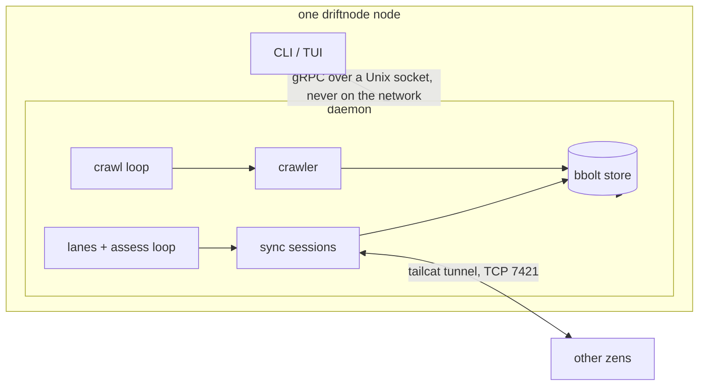
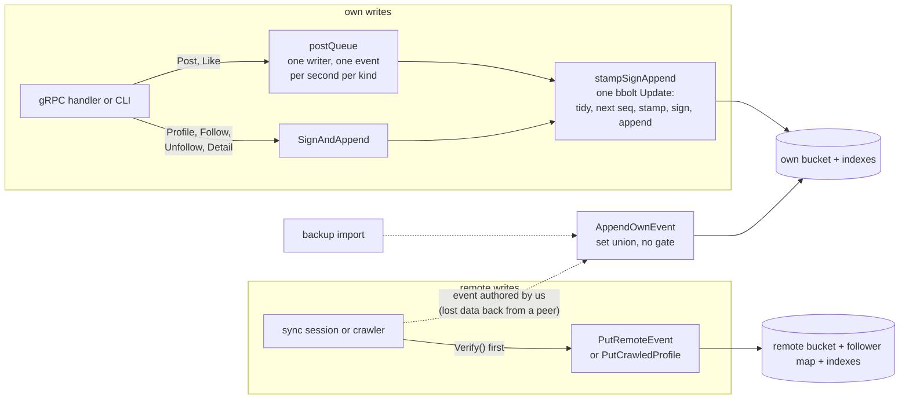
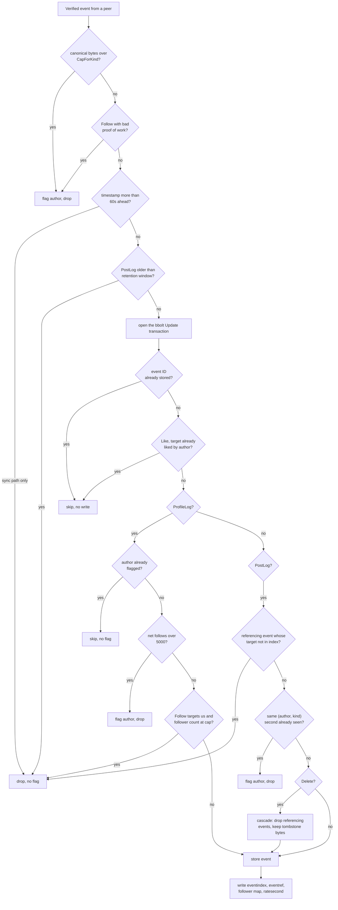
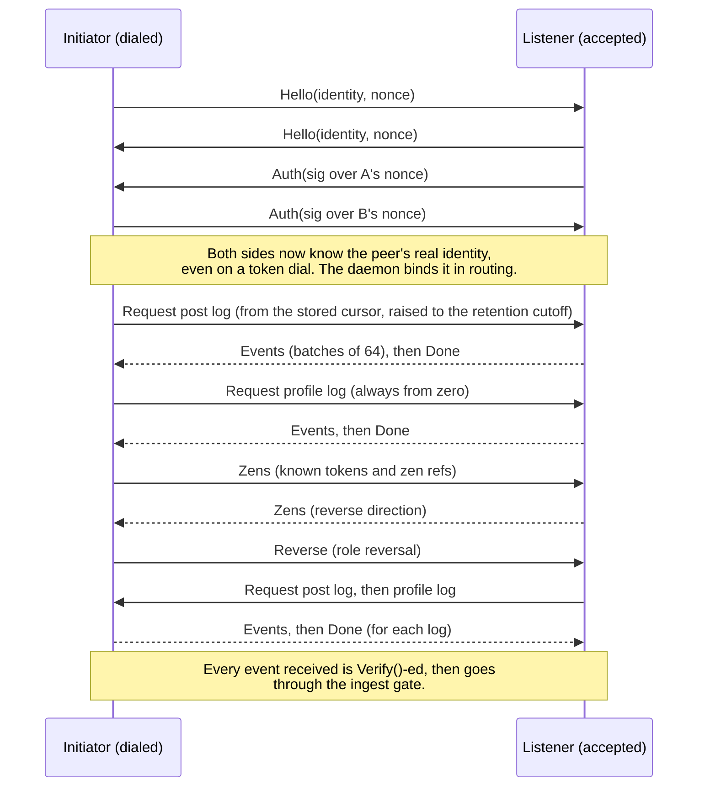
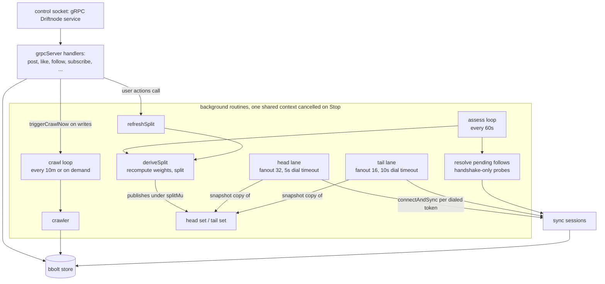

# driftnode architecture

This document describes how driftnode works, derived from the current code.
Where a plan document disagrees with the code, the code wins. It is written so a
fresh agent session can bootstrap without exploring the codebase first.

```text
internal/
  core       identity, canonical CBOR encoding, event model, signing,
             follow proof of work, log projections, backup schema
  store      bbolt persistence: own logs, remote events, follower map,
             indexes, LRUs, ingest gates, rate limiting, backup import/export
  net        tailcat (WireGuard) transport: listener, dialer with client cache
  sync       sync wire protocol and bidirectional sync sessions
  crawler    breadth-first walk of public ProfileLogs
  weight     sync-priority weight formula for followed identities
  daemon     the long-running node: gRPC control socket, background routines,
             signing key custody
  proto      gRPC control-plane definitions (driftnode.v1.Driftnode service)
  cli        cobra commands; talks to the daemon over gRPC, falls back to
             opening the store directly when the daemon is not running
  tui        Bubble Tea dashboard; gRPC client of the daemon only
  bootstrap  parsing and Ed25519 verification of bootstrap.yaml
```

The daemon, CLI, and TUI are one binary. Peer traffic rides tailcat (WireGuard)
tunnels owned by the pinned `github.com/tailscale/tailcat` module; there is no
other network dependency.



## 1. Identity and keys (internal/core/identity.go)

An account is an Ed25519 `core.KeyPair`. The public key is the identity; there
is no recovery except a backup file holding the private key.

- Identity string: `driftnode:<lowercase unpadded base32(pubkey)>`, built by
  `core.IdentityFromPubkey`, parsed by `core.ParseIdentity`. It encodes no
  routing detail. `core.ResolvePubkey` accepts either the full string or the
  bare base32 pubkey.
- The private key is sealed at rest with argon2id (t=3, 32 MiB, 4 threads,
  `core.DefaultKeyEncryption`) and AES-256-GCM, stored as a `core.EncryptedKey`
  in the store's `key` bucket.
- The transport address token (`tc<base64>`) is separate: it is the tailcat
  address derived from a tailcat private key persisted in the store's
  `transport` bucket. The token can rotate (`rotate-key`, `Daemon.rotateKey`)
  without touching the identity. Peers relearn a rotated token through zen
  exchange (section 7).

## 2. Event model and data semantics (internal/core/event.go, encoding.go, log.go)

Every state change is an immutable signed event. A log is a set of events keyed
by event ID, so merging two views is a set union, never a conflict resolution:
`EventID = BLAKE3-256(canonical event bytes)` (`core.EventIDOf`).

- `core.Event{Kind, Log, Timestamp, Sequence}` plus exactly one payload
  pointer set (`Profile`, `Follow`, `Post`, `Like`, `Delete`, `Detail`). The
  one-payload rule is convention: neither `KeyPair.Sign` nor `validateEvent`
  enforces it.
- The canonical encoding is deterministic CBOR (`core.CoreDetEncOptions()`,
  `core.CanonicalEncode`). Those exact bytes are what is signed, hashed, and
  put on the wire.
- `core.SignedEvent{Event, Author, Signature}`: the signature covers the
  canonical bytes of the embedded `Event` only; `Verify()` re-derives the
  author's pubkey from the identity string and checks the Ed25519 signature.
- `Timestamp` is unix nanoseconds; `Sequence` is a per-author per-log monotonic
  counter that never decreases and is never reused.

Kinds, logs, and canonical size caps (`core.CapForKind`; `KeyPair.Sign` refuses
to sign over the cap, so a legitimate author can never produce an oversized
event):

| Kind | Value | Allowed log (validateEvent) | Cap (bytes) | Payload semantics |
|---|---|---|---|---|
| Profile | 1 | profile | 1024 | last-write-wins profile upsert: DisplayName, AvatarHash |
| Follow | 2 | profile | 86 | adds an edge; carries the proof-of-work Nonce |
| Unfollow | 3 | profile | 75 | removes an edge; no proof of work |
| Post | 4 | post | 5120 | text, media hashes, ParentID set means reply |
| Like | 5 | post | 72 | one per author per target, idempotent (dedup at store time) |
| Delete | 6 | post or detail | 72 | tombstone by TargetID |
| Detail | 7 | detail | 2048 | last-write-wins: Bio, FirstName, LastName, Location |

The three logs per identity and what code actually does with each:

| Log | Contents | Treatment in code |
|---|---|---|
| profile | Profile, Follow, Unfollow | public: fetched and cached by any peer's crawler, pulled from zero by every sync session |
| post | Post, Like, Delete | pulled by sync sessions and lanes of followers; bounded by retention and rate limits |
| detail | Detail, Delete | no code path requests it: not crawled, not pulled by sessions or lanes, no on-demand fetch. It is convention-only; nothing restricts a peer from serving one if a request named it |

Derived state is computed by replaying, never stored in the event itself:

- `Log.SortedByTime()`: (Timestamp, Sequence) order, so two zens with different
  partial views compute the same order.
- Profile and Detail: last-write-wins over their log (`Log.Profile`,
  `Log.Detail`).
- Follow set: replay Follow/Unfollow in time order (`Log.FollowSet`).
- Feed: `Log.Posts()`, the non-tombstoned Posts (`Log.Tombstoned` covers
  Delete targets), sorted reverse-chronological. This is the only sort the feed
  path performs; the store returns events in append order and the daemon
  caches the result (`cachedPosts` keyed by `feedGen`).
- A Delete is a tombstone, not erasure: peers that replicated the content
  before the delete may still hold it.
- A Like lives in the liker's own PostLog, never the target's. A like count is
  always "events this zen has observed".

Ownership split that everything else builds on: authored (own) events are
never pruned and are the backup-critical set; everything remote is cache that
re-arrives by sync or crawling after any loss.

## 3. Store layout (internal/store)

One bbolt file, opened by `Open` (store.go), which also creates the buckets via
`initBuckets`. The package is split by concern:

| File | Contents |
|---|---|
| store.go | open, bucket definitions, media, retention, clock |
| keys.go | the sealed keypair, identity, transport key, verified identities |
| routing.go | `routing` and `cursor` buckets |
| ownlogs.go | own-log appends (set union) |
| events.go | signing and appending own events, follow/unfollow, post enqueueing |
| ratelimit.go | the author-side post queue and its one-per-second-per-kind limit |
| ingest.go | remote ingest, the follow-state cache, crawled reads |
| reads.go | feed, follow graph, followers, likes |
| eventindex.go | `eventindex` and `eventref`, delete cascade |
| followermap.go | the derived follower map |
| tidyprofile.go | tidy-at-write for the own ProfileLog |
| crawllru.go, tokenlru.go, lru.go | the two bucket-pair LRUs and their shared machinery |
| weights.go | weight computation over the follow graph |
| prune.go | retention pruning |
| backup.go | backup export and import |
| helpers.go | shared key encodings and the sequence counter |

`DRIFTNODE_RETENTION` (a Go duration, e.g. "720h") sets the PostLog retention
window; empty or zero disables retention.

| Bucket | Key | Value | Meaning |
|---|---|---|---|
| `meta` | `identity`, `followercount` | identity string; uint64 BE | local identity; follower-map record count |
| `key` | `key` | EncryptedKey CBOR | the sealed account keypair |
| `own` | sub-bucket per log name, then 32-byte event ID | SignedEvent CBOR | own three logs |
| `remote` | sub-bucket per author identity, then 32-byte event ID or `0x01 ++ 32-byte follow-target pubkey` | event CBOR, or the winning Follow's event ID | synced and crawled events, plus follower-map records |
| `media` | content hash | blob bytes | content-addressed store; `PutMedia`/`GetMedia` exist, no writer or fetch path calls them yet |
| `routing` | identity | address token | identity to token binding |
| `verified` | identity | presence | out-of-band confirmed identities |
| `followstate` | identity | `[3]byte{followed, pinned, flagged}` | local per-identity flags cache, rebuilt from the own ProfileLog by `rebuildFollowState` |
| `transport` | `tailcat` | tailcat private key JSON (as `KeyBytes` produces) | stable node address; sealed with argon2id + AES-GCM only in the backup file |
| `cursor` | identity ++ log | uint64 ns | PostLog high-water mark per (zen, log) |
| `weight` | identity | float64 | sync-priority weight; the whole bucket is replaced on each `RecomputeWeights` pass |
| `ratesecond` | identity ++ kind byte | uint64 second | last seen second per (author, kind), for the receiver-side rate check |
| `eventindex` | event ID | author ++ kind byte | existence index over post-log events |
| `eventref` | target ID ++ source ID | author ++ kind byte | reference index (likes, replies, deletes) |
| `crawllru` + `crawlts` | `crawllru`: unix-ns touch time ++ identity; `crawlts`: identity | `crawllru`: empty marker; `crawlts`: the touch time | the crawl cache LRU as a bucket pair: `crawllru` is keyed by touch time so the coldest entry sorts first, `crawlts` maps back identity to its touch time so a re-crawl can delete the old key before writing the new one |
| `tokenlru` + `tokents` | `tokenlru`: unix-ns touch time ++ token; `tokents`: token | `tokenlru`: empty marker; `tokents`: the touch time | the discovered-token LRU, same bucket-pair shape as the crawl cache |
| `bootstraptk` | token | presence | bootstrap tokens; kept by the token LRU's keep predicate |
| `seq` | log name | uint64 | per-log sequence counter |

Derived records (follower map, eventindex, eventref) are written inside the
same bbolt Update transaction as the event they describe; there is no path
that stores an event and indexes it later.

The follower map (internal/store/followermap.go) is one record per follower,
stored inside the follower's own author bucket in `remote`, keyed by
`followMapPrefix ++ target pubkey`. Because the record lives in the author
bucket next to the Follow evidence bytes, crawl eviction deletes record and
evidence together: the map can never claim a follower whose proof was
deleted. A rebuild flag (`followersNeedsRebuild`) is set at `Open` and by any
whole-bucket author deletion; the map is recomputed from all stored
Follow/Unfollow events by the first follower read
(`ensureFollowersReady`). Between rebuilds, ingest maintains the map
incrementally with newest-wins on (timestamp, sequence) (`applyFollowMapTx`),
matching the replay.

## 4. Write paths

All own writes go through `store.stampSignAppend`, and all remote writes go
through `store.PutRemoteEvent` or `store.PutCrawledProfile`.



### Own writes, synchronous (`store.SignAndAppend`)

Used for Profile, Follow, Unfollow, and Detail events. One bbolt Update
transaction: for the ProfileLog, `tidyProfileLogTx` first removes the events
the new one supersedes (a Follow or Unfollow removes every prior Follow and
Unfollow for that target pubkey; a Profile removes the prior Profile), then
take the next `seq` value, stamp `Timestamp = core.Now64()`, sign, append.
Because the log is compacted at every write, the whole family is
synchronous and not rate-limited: bulk-follow onboarding is a legitimate
burst, and its cost is only the compacted remainder.

Tidy is the ProfileLog's whole storage-bounding story, so its full shape:

- Where it runs: inside `stampSignAppend`'s transaction, before the new
  event is appended, and only on the own ProfileLog. No other path
  compacts: remote (crawled) ProfileLogs are stored verbatim and replayed,
  `AppendOwnEvent` (sync-back, described next, and backup import) is a plain
  set union, and the DetailLog is not tidied at all (a new Detail keeps
  prior Details; the last-write-wins projection hides them).
- What it leaves: one event per target (a Follow if currently followed, an
  Unfollow if followed then unfollowed) and one Profile event. A
  follow/unfollow cycle leaves exactly one event, the latest, never one
  per cycle.
- The lookup is by target pubkey (Follow, Unfollow) or by kind (Profile),
  a scan bounded by the follow cap, at most ~5001 events.
- Sequence numbers are not reused after a tidy removal: `nextSequence`
  keeps a per-log counter in the `seq` bucket that only advances; deriving
  it from the key count would produce a colliding or lower number after a
  removal.
- What depends on it: a peer's `pullLog` always pulls the ProfileLog from
  zero precisely because the log is compact (small, and the replay
  re-derives the follower map, so a wiped zen heals in one session); the
  follow-set and profile projections remain correct on replay because
  only state-relevant events survive; and bootstrap re-follows are
  idempotent because a new Follow replaces the prior edge rather than
  adding a second one.
- The edge to know about: events tidied away on side A still exist in
  peers' replicas of A's log (including A's own backup taken before the
  tidy). Sync-back, the flow where a session hands a peer's replica of our
  own log back to us, and backup import re-add them via `AppendOwnEvent`
  without re-tidying. Replay hides them (the newer event wins by
  (Timestamp, Sequence)), so the projection is unaffected; only the stored
  set is larger than the tidied one.

Guards inside `SignAndAppend`:
- A Like whose (author, target) is already stored returns the existing event
  ID without writing.
- A Follow that would push the projected follow set past `core.MaxFollows`
  (5000) returns `core.ErrFollowCapExceeded`. Re-following an already-followed
  target is allowed.
- A Follow grinds its nonce first (`core.GrindFollowNonce`).

`store.Follow` and `store.Unfollow` wrap `SignAndAppend` and also maintain the
`followstate` cache (`followed=true` on follow, record deleted on unfollow,
which clears any pin with it). The daemon and the offline CLI both route
through these two methods so the cache never disagrees with the signed graph.
The flag slot is the only part not owned by this path: it is written by the
ingest gate (section 5) and never cleared except by a from-zero rebuild
(`rebuildFollowState` on backup import).

### Own PostLog writes, rate limited (`store.EnqueuePostEvent`)

Used for Post and Like. The call enqueues the unsigned event and returns a
result channel plus `store.ErrHeld`; the caller blocks on the channel. A single
background goroutine (`postQueue`, internal/store/ratelimit.go) drains it at
one event per second per kind: when the current second is already taken it
sleeps until the next real second and then stamps the real wall clock, so the
signed timestamp reflects when the event was actually produced. The queue cap
is 10; an 11th caller gets `store.ErrRateLimitQueueFull` immediately. The
per-kind last-second map is seeded from the last stored event of that kind on
first use (`lastStoredSecondOfKind`), so a restart cannot emit two same-second
events. The single goroutine is also the only writer of own PostLog events, so
sequence numbers cannot collide.

The receiver enforces the same one-per-second-per-kind bound independently at
ingest (the `ratesecond` check in the gate table, section 5), and flags a
violator. The future-skew check is what bounds clock drift between the two
sides: an author cannot stamp events into the future to dodge the
receiver-side comparison.

There is no CLI command or RPC that writes a Delete to one's own PostLog. A
tombstone only enters the own log via sync (a peer serving back our own cached
event) or backup import.

Delete is one mechanism split across two layers, and the split is deliberate:

- Store layer, remote ingest (`cascadeDelete` in eventindex.go): once a
  verified Delete for an existing target is stored, the cascade removes every
  stored event referencing the target (its likes, replies) with their index
  entries, removes the target from `eventindex`, but keeps the target's and
  tombstone's bytes in the bucket so a re-receive dedups instead of
  resurrecting. With the target gone from the existence index, any future
  Like or reply targeting it is dropped as an orphan by the gate.
- Projection layer, replay (`Log.Tombstoned`, `Log.Posts`): a log that holds
  both a post and its own Delete event (the usual case for the own log after
  sync-back, where `AppendOwnEvent` stored the tombstone without any cascade)
  filters the post at read time instead of removing bytes. The feed path
  (`AllPostsOneTx` then `Log.Posts`) relies on this.

### Remote writes (sync and crawler)

- `store.PutRemoteEvent(se, seq)`, called by sync sessions (after
  `se.Verify()`) and by the fetch-likes handler. Pre-transaction checks, then
  all remaining checks and writes inside one Update. The full gate is the
  subject of section 5.
- `store.PutCrawledProfile(author, se)`, called by the crawler for verified
  ProfileLog events. It applies the same checks as the sync path except
  future-skew and retention, which do not apply to the crawler (section 5).
- If a sync session receives an event authored by the local identity itself
  (data was lost locally, a peer still holds it), `routeSyncedEvent` sends it
  to `store.AppendOwnEvent`: plain set-union, no gate, because a valid
  signature from our own key means the event was legitimate when signed.

### Backup (store.ExportBackup / ImportBackup, section 11)

Export reads; import decrypts the sealed keypair, refuses any backup belonging
to a different identity than the store's, then merges own logs by set union
via `AppendOwnEvent`.

## 5. Ingest gate and read paths

### Ingest gate

Both entry points verify the signature first (the callers call `Verify()`).
`PutRemoteEvent` then runs the ordered checks below: every "flag" termination
writes the followstate flag; every "drop" terminations discards the event and
returns. The gate is a sequential pipeline, so the diagram matches the
precedence the code enforces.



`PutCrawledProfile` applies the same pre-transaction checks 1 and 2, then
inside the transaction the set union, the like check, and the flagged-author,
follow-cap, and follower-cap checks; it applies no skew or retention check
and no PostLog-only checks, since the crawler only stores ProfileLog events.

Reference for the constants and flag policy behind the diagram:

| Check | Scope | On violation |
|---|---|---|
| size cap over `CapForKind` | all events, pre-transaction | flag and drop |
| follow proof of work (`core.VerifyFollowWork`) | Follow events, pre-transaction | flag and drop |
| future skew over `MaxFutureSkew` 60s | sync path only, pre-transaction | drop, no flag |
| retention window (`DRIFTNODE_RETENTION`) | PostLog, sync path only, pre-transaction | drop, no flag |
| set union by event ID | all events, in-transaction | skip silently |
| one like per author per target (`existingLikeID`) | Like events, in-transaction | skip silently |
| flagged author | ProfileLog, in-transaction | skip, no re-flag |
| net follows over `MaxFollows` 5000 | ProfileLog, in-transaction | flag and drop |
| follower cap `MaxFollowers` 2^33 | Follows targeting us, in-transaction | drop, no flag |
| orphan reference (target not in `eventindex`) | referencing PostLog events, in-transaction | drop, no flag |
| same (author, kind) second (`ratesecond`) | PostLog, in-transaction | flag and drop |
| Delete cascade (`cascadeDelete`) | PostLog Delete, in-transaction | removes referencing events, keeps tombstone bytes |

The no-framing invariant: every flagged violation was covered by a valid
signature, so a flag always means the author's own key misbehaved; everything
environmental (skew, follower flood, orphan) never flags.

### Read paths

- Feed (`store.AllPostsOneTx`): own PostLog plus every followed identity's
  PostLog events, in one View transaction, ordered by `Log.Posts()`. The
  daemon caches this (`feedGen` is bumped by `invalidateFeed` on every own
  post-log write and on posts or likes merged by a sync session or the
  fetch-likes handler).
- Follow graph (`store.FollowGraph`): replayed from the own ProfileLog.
- Followers (`store.ReceivedFollowers`, `ReceivedFollowEvents`): from the
  derived follower map (rebuild-on-read, section 3).
- Display names (`store.DisplayName`): last-write-wins over the own or the
  crawled ProfileLog of the identity.
- Likes for posts (`store.LikesForPosts`): `eventref` prefix scan by target ID.
- Detail: replay of the DetailLog; no fetch path exists for it (section 2),
  so a peer renders a stranger's details only from events it already holds.
- Routing, cursors, weights: direct bucket lookups.

## 6. Protection mechanisms

Authenticity and protocol enforcement (all verified above):

| Mechanism | Where |
|---|---|
| Ed25519 signature check on every received event, before any store write | sync/crawler callers of the gate |
| per-kind canonical size caps, enforced at sign time so an over-cap event means a hostile author | `core.KeyPair.Sign`; gate size-cap row |
| Follow proof of work: 19 leading zero bits of BLAKE3-256 over `author ++ target ++ nonce` (`core.followWorkHash`), so work cannot be amortized across targets or keypairs; roughly 100ms on the reference machine | `core.GrindFollowNonce`; gate proof-of-work row |
| author flag: a flagged author's future ProfileLog events are skipped (`followstate` slot 3, written only on signature-verified violations) | gate flagged-author row |
| receiver-side same-second rate check per (author, kind) | gate + `ratesecond` |
| author-side rate limit: one event per second per kind on own PostLog writes, plus a waiting-room queue of at most 10 events | `postQueue` |
| future-skew rejection | gate future-skew row |
| optional PostLog retention window: drop at ingest, prune stored (`PruneRemotePosts`, run on daemon stop and by the `prune` command/RPC) | `DRIFTNODE_RETENTION` |
| orphan rejection for referencing PostLog events | gate orphan-reference row |
| follower cap (2^33, silent drop) | gate follower-cap row |

Resource bounds:

| Bound | Value |
|---|---|
| sync wire frame cap (`maxFrameSize`) | 16 MiB |
| crawl cache LRU (`maxCache`), followed identities kept by the `keep` predicate | 10000 identities |
| token LRU (`maxTokenCacheDefault`), routing-bound and bootstrap tokens kept | 10000 tokens |
| dialer client cache: one tailcat client per dialed address, LRU cap 64; any dial error evicts that address's client so a wedged tunnel is never reused | `defaultCachedClients` |
| head lane per-dial timeout / fanout | 5s / 32 |
| tail lane per-dial timeout / fanout | 10s / 16 |
| on-demand dial timeout (follow-by-token, pending resolution, bootstrap) | 30s |
| subscribe push queue per subscriber | 256; a full queue drops that subscriber |

The remote bucket is self-healing cache: crawl eviction (`EvictCrawl`) removes
the coldest non-followed identities' buckets (with their index entries), and
everything removed re-arrives through sync (followed zens) and crawling (public
profiles). That is why remote data can be dropped at any time without loss.

## 7. Transport and sync (internal/net, internal/sync)

All peer traffic runs over tailcat tunnels, TCP port `core/net.SyncPort`
(7421), carrying a length-prefixed CBOR message protocol (`WriteMsg`/
`ReadMsg`, frame cap 16 MiB). The gRPC control plane is a local Unix socket
only (`SocketPathFor` derives the path from the store path) and is never
exposed on the network.

### Handshake (`Session.Handshake`)

Both sides send `Hello{Identity, Nonce}`, then sign the other side's nonce and
send `Auth{Signature}`. Send and receive run concurrently to avoid deadlock on
unbuffered connections. Success authenticates both Ed25519 identities and
returns the peer's identity, which is how a token dial reveals who answered
(`SetAuthed` callback; the daemon binds identity to token in `routing` on this
basis in `connectAndSync`).

### Session flow (`RunInitiator` / `RunListener`)

One connection, both directions:



Pull mechanics (`pullLog`):

- PostLog pulls start from the stored per-(zen, log) cursor
   (`store.SyncCursor`), raised to the retention cutoff so the peer does not
   send what the receiver would drop. After the pull, `advanceCursor` stores
   max received timestamp minus a 5-minute skew window
   (`cursorSkewWindow`), never backwards; re-transfer inside the window is
   cheap because `PutRemoteEvent` is a set union.
- ProfileLog pulls always start from zero: the tidied log is small, and
   pulling it from zero re-derives the follower map, so a wiped zen heals in
   one session.
- Every event is `Verify()`-ed on receipt before going through the gate.
- EOF before `MsgDone` is a clean end: received events are kept and the PostLog
   cursor still advances over them.

Beyond log pulls, the connection serves three request types used by the
crawler and the like-fetch feature: followers (`Server.handleFollowers` sends
the signed Follow events received targeting the local identity), likes
(`handleLikeRequest` matches Like events by target ID), and a raw log request
for a third-party author (`Server.fetchEvents` serves the local own log or the
cached events for that author). All relayed events are self-certifying, since
the requester verifies each original author's signature.

## 8. Discovery: zen exchange, the token LRU, and the crawler

Discovery is one mechanism with three cooperating parts; a node that reaches
one well-connected zen finds the rest of the network transitively.

1. Zen exchange rides every session (step 6 of the session diagram). Each
   side sends its known tokens and zen refs; `learnZenRefs` persists the
   tokens through `LearnTokens` (one transaction per batch) and, for refs
   carrying an identity hint, seeds the crawler and records the hint on the
   in-memory zens entry. The hints are display-only until the crawler fetches
   that identity's signed ProfileLog, which is the authoritative source for
   name and identity.
2. The token LRU caps what is remembered (10000, `maxTokenCacheDefault`)
   and decides what is kept under pressure: routing-bound tokens (they
   reach followed identities) and bootstrap tokens (`bootstraptk`) are
   never evicted (`tokenKeep`). Eviction is self-healing: tokens are
   offered on every session, so an evicted token is relearned from the
   next holder that still has it hot.
3. The crawler walks public ProfileLogs from its seed set (bootstrap
   `crawl_seeds` plus identities picked up from zen exchange), breadth-first
   up to `maxDepth` 5, fetching with `crawlFetch` (any known zen that holds
   the log) and building the next frontier from both directions: out-edges
   (the profile's follows) and in-edges (`crawlFetchFollowers` asks the
   identity's own zen for the Follow events it has received targeting
   itself). Visited identities live in the persisted crawl LRU; `EvictCrawl`
   trims to `maxCache` 10000 and never evicts a followed identity, whose
   bucket also holds synced PostLog events. A concurrent `Run` is rejected;
   on-demand triggers coalesce through the single-slot `crawlNow` channel.

## 9. Daemon (internal/daemon)

The daemon is the long-running node. It owns the store while running, serves
gRPC on the Unix socket, and runs four background routines sharing one context
cancelled by `Stop`: crawl loop, assess loop, head lane, tail lane. The
package is split by concern:

| File | Contents |
|---|---|
| daemon.go | lifecycle (`Start`, `Stop`), shared state, tailcat transport |
| server_grpc.go | the gRPC surface over the handlers |
| handlers.go | signing handlers, key custody, follow/unfollow logic |
| feed.go | the feed cache and its invalidation |
| pubsub.go | subscriber push and the per-subscriber queue |
| scheduler.go | assess loop, head and tail lanes, sync dialing, the split |
| crawl.go | crawl loop, crawl fetching, like fetching |
| zens.go | the zen table, token learning, zen exchange glue |
| bootstrapping.go | dialing bootstrap seeds, deferred seed follows |
| protoconv.go | proto conversion helpers |

On `Start` it seeds the head/tail split from persisted weights without dialing
(`seedSplit`), rehydrates the zens map from `routing` and the token LRU
(`rehydrateZens`), and triggers an immediate crawl. On `Stop` it prunes remote
PostLog events past the retention window.



### Sync lanes and the head/tail split

Every bound follow (one with a `routing` binding) is weighted, sorted, and
split once per assess pass:

- Weights (`internal/weight`): log-scaled outbound likes
  (`wLikes` 0.4) and outbound replies (`wReplies` 0.5), each saturating at a
  soft cap set to the 99th percentile of that metric measured on a reference
  dataset (20 likes, 13 replies), so the heaviest authors tie at the ceiling
  while the log scale spreads the rest; plus a reciprocity bonus (`wRecip`
  0.1); plus a pin term (`wPin` 1.5) that dominates the sum, so a pin
  outranks any emergent interaction signal. A follow with no signal at all
  gets `coldStartWeight` 0.05. Inputs are gathered from the store in one
  transaction (`gatherWeightInputs`); the weight bucket is fully replaced
  each recompute.
- `splitHeadTail`: sort by weight descending with the identity string as
  tiebreak, head = top K where K is one third of the bound follows, minimum
  1, capped at `maxHeadSize` 150; tail = the rest.
- The head lane dials its set continuously with fanout 32 and a 5s per-dial
  timeout, so an unresponsive zen releases its concurrency slot quickly and
  one bad follow cannot stall the pass; the tail lane runs fanout 16, 10s.
  Both pause 5s (`laneBackoff`) between
  passes. Lanes copy the current split under `splitMu` and dial against that
  snapshot, so a mid-pass re-derive never tears the set.
- User actions (follow, unfollow, pin, unpin) call `refreshSplit` immediately
  instead of waiting for the next assess pass.

### Assess loop (every 60s, `assessPeriod`)

`assess` resolves pending follows (followed identities with no `routing`
binding) by dialing known tokens and running only a handshake: if the identity
that answers is in the pending set, bind the token and sync it. Only the
handshake runs for non-matching tokens, so probing cannot leak a non-followed
zen's PostLog into the feed's source set. It then calls `deriveSplit`
(recompute weights, re-derive and publish the split).

### Crawl loop (every 10 minutes, `crawlInterval`; `triggerCrawlNow` on demand)

An immediate crawl pass is triggered by any post, like, follow, unfollow,
profile, or detail write, by the `sync` RPC, and at daemon start. The buffered
one-slot channel drops extra signals while a pass is pending.

### Key custody

The daemon holds the signing key in memory only while unlocked:
`daemon unlock` decrypts and caches it; `daemon lock` and `Stop` clear it;
an optional `--idle-lock` expiry (`SetIdleLock`) is checked lazily at the
next signing attempt (`signingKey`), and every signing handler refreshes
`lastSignAt`. A wrong passphrase in `handleUnlock` never replaces an
already-unlocked key.

### Subscriber push (gRPC `Subscribe`)

Each subscriber gets one full snapshot then incremental diffs (feed items,
zens, follows, followers, status) over a per-subscriber queue of 256; a full
queue drops that subscriber (`broadcast` never blocks the daemon). The feed
snapshot and diffs come from the `feedGen`-guarded cache; sync sessions
collect merged posts and new followers via `Session.SetOnMerge` and emit them
once per session.

## 10. CLI and TUI (internal/cli, internal/tui)

Every command that touches a store or the daemon takes a required `--db`; the
control socket path is derived from it, so multiple daemons on one machine do
not collide. The daemon gRPC surface is defined in `internal/proto/driftnode.proto`
(Whoami, Follows, Followers, Post, Like, FetchLikes, Profile, Detail, Zens,
Verify/Unverify, Pin/Unpin, Follow/Unfollow, Unlock/Lock, Sync, Stop, Status,
RotateKey, Subscribe, FeedPage, Prune).

Command classes, verified from the cobra definitions in internal/cli, where
root.go carries the root command, init, unlock, lock, sync, and the shared
helpers, and each remaining command family lives in its own cmd_*.go file:

- Online-first with offline fallback: post, like, feed, follow, unfollow,
  follows, followers, whoami, profile, detail, prune, and the zens mark
  commands (verify/unverify/pin/unpin). They try the daemon RPC; if the
  daemon is not running they open the store directly and require `-p` for
  signing.
- Direct store only: init, key export/import, backup export/import.
  `backup export` requires `-p` when there is a transport key to seal.
- Daemon-only: tui, sync, rotate-key, zens list, daemon lifecycle commands
  (start/stop/restart/status/unlock/lock). The TUI is a gRPC client of the
  daemon and never opens the store.
- No store at all: bootstrap keygen/sign/verify, relay subcommands (status,
  enable, disable; the relay commands are placeholders).

When the daemon is running, all writes go through its RPCs so its caches and
subscriber diffs stay consistent; the CLI never mutates the store concurrently
behind the daemon. bbolt's file lock (5s `Open` timeout) serializes the rest.

## 11. Backup (internal/core/backup.go, store Export/Import, cli)

`ExportBackup` collects: the EncryptedKey (sealed keypair), all own events
(`AllOwnEvents`: Profile, Detail, Post logs), the verified identities, and the
pinned identities. The CLI additionally seals the tailcat transport key under
the same passphrase (`EncryptBytes`), so the address token survives a device
restore. Everything remote is excluded: it is cache and re-arrives after
import. `core.BackupData` also has a `Petnames` field; nothing writes or
restores it today.

`ImportBackup` restores the account: decrypt the keypair (passphrase
required), refuse a backup whose identity differs from the store's, merge own
logs by set union (`AppendOwnEvent`), replace the local verified set with the
backup's in one write, rebuild the follow-state cache from the own ProfileLog,
then re-apply pins (which require a follow edge). Re-import is idempotent.
The BackupData is canonical CBOR throughout; driftnode is pre-production, so
there are no on-disk migrations.

## 12. Bootstrap (internal/bootstrap/bootstrap.go)

A bootstrap.yaml (`version`, `signature`, `seed_relays`, `derp_relays`,
`seed_zens`, `crawl_seeds`) is signed with Ed25519 over the canonical YAML of
its content fields (`Sign`/`Verify`); the signature string is `ed25519:<hex>`.
At daemon start (`dialBootstrapSeeds`, passed `--bootstrap` and
`--bootstrap-key`, base64 public key): verify the signature when a key is
supplied (without one the file loads unverified, with a log line), persist the
seed tokens as bootstrap-pinned (exempt from token LRU eviction), seed the
crawler from `crawl_seeds` (works while the key is locked), and follow each
`seed_zens` entry, with up to 3 passes 5s apart for temporarily-down seeds.
If the signing key is locked at the time, the seed follows defer until the
next `daemon unlock` (the `bootstrapDone` flag is only set after a completed
pass). Following one seed is sufficient: zen exchange spreads the rest.

`seed_relays` and `derp_relays` are parsed into the File struct but consumed
by no code path.

## 13. Conventions an agent should not re-derive

- Identity strings, event IDs, and content hashes are lowercase unpadded
  base32 in text form. The event index buckets key on the raw 32-byte ID,
  never the string.
- All event and key serialization is canonical CBOR. Two exceptions: the
  tailcat transport key is JSON (the tailcat library's own serialization),
  and the bootstrap file is signed YAML.
- `followstate` slot 3 (`flagged`) is written only in response to a
  signature-verified protocol violation (oversized event, workless follow,
  over-cap follow set, same-second duplicate). Everything the author side
  could have prevented is flaggable; everything environmental (clock skew,
  follower flood) is not.
- UI glyph constants live in `internal/core/symbols.go` (like, pin,
  verified). Use them instead of hard-coding glyphs.
- An identity is permanent; only the address token rotates. Peers re-learn a
  rotated token through zen exchange or a follow resolution handshake.
- `core.MaxFollows` (5000) is author-enforced; `core.MaxFollowers` (2^33) is
  receiver-enforced. The former flags on violation, the latter drops
  silently.
